# GNotes

Plataforma comunitaria para crear y compartir guías de videojuegos. Los usuarios publican guías (jefes, builds, secretos, etc.), las votan, comentan y guardan en favoritos; los moderadores revisan reportes y contenido con palabras prohibidas, y los administradores gestionan roles y sanciones.

- **API** (`API/`): Node.js, Express 5 y MongoDB con Mongoose. Puerto 5001, rutas bajo `/api`.
- **Frontend** (`Frontend/`): HTML, Bootstrap 5 y JavaScript, servido con Express. Puerto 5002.

## Requisitos

- Node.js 18 o superior (usa `fetch` nativo).
- MongoDB local (`mongodb://127.0.0.1:27017`) o una base en MongoDB Atlas.

## Instalación y ejecución

1. Clonar el repositorio:

   ```bash
   git clone https://github.com/B0W3YYY/Gnotes.git
   cd Gnotes
   ```

2. Levantar MongoDB. Si está instalado como servicio ya está corriendo; si no, en otra terminal: `mongod --dbpath <carpeta-de-datos>`. Con Atlas no hace falta, basta con poner su URI en el `.env`.

3. Configurar e iniciar la API:

   ```bash
   cd API
   npm install
   cp .env.example .env
   npm run dev
   ```

   En `.env` cambia `JWT_SECRET` por una clave larga y, si usas Atlas, `MONGO_URI`. Debe aparecer `MongoDB conectado` y `Servidor corriendo en http://localhost:5001`. `npm start` la inicia sin nodemon.

4. En otra terminal, iniciar el frontend:

   ```bash
   cd Frontend
   npm install
   npm run dev
   ```

5. Abrir http://localhost:5002

### Variables de entorno (`API/.env`)

| Variable | Ejemplo | Para qué |
|---|---|---|
| `PORT` | `5001` | Puerto de la API |
| `MONGO_URI` | `mongodb://127.0.0.1:27017/proyectoIntegrador` | Conexión a MongoDB |
| `JWT_SECRET` | una clave larga | Firmar los tokens de sesión |
| `FRONTEND_URL` | `http://localhost:5002` | Enlace del correo de recuperación |
| `EMAIL_API_URL` | URL del servicio de correo | Enviar el correo de recuperación |

El `.env` real no se sube (está en `.gitignore`); `.env.example` es la plantilla.

### Crear el primer administrador

Regístrate desde la página y luego, en la carpeta `API`:

```bash
npm run admin -- tu-correo@ejemplo.com
```

## Estructura de la API

```
API/
├── config/db.js          Conexión a MongoDB (eventos connected, error y disconnected)
├── models/               Esquemas de Mongoose con sus validaciones
├── controllers/          Lógica de cada recurso
├── routes/               Rutas: solo enlazan URL, middlewares y controlador
├── middlewares/          auth (sesión y roles), validarId, errores (404 y manejo central)
├── utils/                Palabras y emojis prohibidos, historial de moderación
├── scripts/smoke-test.js Prueba rápida de todos los endpoints
├── pruebas/prueba-api.js Prueba de punta a punta de las reglas de negocio
└── server.js             Arma la app y monta las rutas
```

### Entidades

| Modelo | Qué guarda | Relaciones |
|---|---|---|
| `Usuario` | Nombre, correo (único, validado), contraseña con bcrypt, rol, biografía, favoritos | `favoritos` → Guia |
| `Guia` | Título, juego, categoría, dificultad, contenido, estado, votos, vistas | `autor` → Usuario, `votos` → Usuario |
| `Comentario` | Texto (máx. 1000), estado | `guia` → Guia, `autor` → Usuario |
| `Reporte` | Tipo (guia/comentario), motivo, estado | `reportadoPor` → Usuario |
| `Sancion` | Tipo (advertencia/suspensión/bloqueo), motivo, hasta, activa | `usuario` y `aplicadaPor` → Usuario |
| `PalabraProhibida` | Palabra única en minúsculas | — |
| `AccionModeracion` | Historial de acciones de moderadores y admins | `realizadaPor` → Usuario |
| `Curso`, `Roles` | CRUD visto en clase | — |

Todos usan `timestamps` (`createdAt` y `updatedAt`). La contraseña nunca se devuelve en las respuestas.

## Rutas de la API

Base: `http://localhost:5001/api`. Las rutas con 🔒 necesitan el encabezado `Authorization: Bearer <token>` (el token lo devuelven el registro y el login).

### Salud

| Método | URL | Respuestas |
|---|---|---|
| GET | `http://localhost:5001/` | 200 `{ "ok": true, "message": "API de GNotes funcionando" }` |

### Usuarios (`/api/usuarios`)

| Método | URL | Acceso | Body de ejemplo | Respuestas |
|---|---|---|---|---|
| POST | `/usuarios` | Público | `{ "nombre": "Ana", "correo": "ana@mail.com", "clave": "clave123" }` | 201 `{ token, usuario }`, 400 |
| POST | `/usuarios/login` | Público | `{ "correo": "ana@mail.com", "clave": "clave123" }` | 200 `{ token, usuario }`, 401, 403 (sancionado) |
| POST | `/usuarios/recuperar` | Público | `{ "correo": "ana@mail.com" }` | 200 (igual exista o no) |
| POST | `/usuarios/restablecer` | Público | `{ "token": "<del correo>", "clave": "nueva123" }` | 200, 400 |
| GET | `/usuarios/perfil` | 🔒 | — | 200, 401 |
| PUT | `/usuarios/perfil` | 🔒 | `{ "nombre": "Ana", "correo": "ana@mail.com", "biografia": "Hola" }` | 200, 400 |
| PUT | `/usuarios/perfil/clave` | 🔒 | `{ "actual": "clave123", "nueva": "clave456" }` | 200, 400 |
| DELETE | `/usuarios/perfil` | 🔒 | `{ "clave": "clave123" }` | 200, 400 |
| GET | `/usuarios/perfil/estadisticas` | 🔒 | — | 200 |
| GET | `/usuarios/perfil/favoritos` | 🔒 | — | 200 |
| GET | `/usuarios` | 🔒 Admin | — | 200, 403 |
| GET | `/usuarios/:id` | Público | — | 200, 400, 404 |
| PUT | `/usuarios/:id/rol` | 🔒 Admin | `{ "rol": "moderador" }` | 200, 400, 404 |
| DELETE | `/usuarios/:id` | 🔒 Admin | — | 200, 400, 404 |

### Guías (`/api/guias`)

| Método | URL | Acceso | Body de ejemplo | Respuestas |
|---|---|---|---|---|
| GET | `/guias` | Público | Query: `q`, `juego`, `categoria`, `dificultad`, `autor`, `orden=recientes\|antiguas\|votadas\|vistas\|titulo` | 200 |
| GET | `/guias/opciones` | Público | — | 200 `{ categorias, dificultades }` |
| GET | `/guias/:id` | Público | — | 200, 400, 404 |
| POST | `/guias` | 🔒 | `{ "titulo": "Cómo vencer a Margit", "juego": "ELDEN RING", "categoria": "Jefes", "dificultad": "Difícil", "contenido": "..." }` | 201, 400, 401, 403 |
| PUT | `/guias/:id` | 🔒 Autor | `{ "titulo": "Nuevo título" }` | 200, 400, 403, 404 |
| DELETE | `/guias/:id` | 🔒 Autor o moderador | — | 200, 403, 404 |
| POST | `/guias/:id/voto` | 🔒 | — | 200 `{ yaVoto, totalVotos }`, 400, 404 |
| POST | `/guias/:id/favorito` | 🔒 | — | 200 `{ esFavorito }`, 404 |
| POST | `/guias/:id/compartir` | Público | — | 200 `{ compartidos }`, 404 |
| POST | `/guias/multimedia` | 🔒 | `multipart/form-data`, campo `archivos` (1 a 10 archivos) | 201 `{ archivos: [{ tipo, url, nombre }] }`, 400, 401, 403, 413, 415 |
| GET | `/uploads/:archivo` | Público | (fuera de `/api`) sirve el archivo subido | 200, 404 |

Si una guía tiene palabras prohibidas queda en estado `pendiente` hasta que un moderador la revise.

#### Juegos nuevos

Si al crear o editar una guía el `juego` no está en la lista de la web (`Frontend/public/js/juegos.js`) ni entre los aprobados, la guía se guarda con `juegoNuevo: true` y estado `pendiente`. El nombre debe tener 2 a 60 caracteres (letras, números, espacios y `: ' - & ! . , + ( )`); mayúsculas, tildes y signos no cuentan para detectar duplicados. Si el juego ya existe, se guarda con su nombre oficial. Un moderador no puede publicar esas guías (409): las aprueba o rechaza un admin.

| Método | URL | Acceso | Body de ejemplo | Respuestas |
|---|---|---|---|---|
| GET | `/juegos` | Público | — | 200 `[{ nombre, icono, estandarte }]` |
| GET | `/admin/juegos/solicitudes` | 🔒 Admin | — | 200 |
| PUT | `/admin/juegos/solicitudes/:id/aprobar` | 🔒 Admin | `{ "nombre": "Nombre corregido", "icono": "/uploads/....png" }` (opcional) | 200, 400, 404 |
| PUT | `/admin/juegos/solicitudes/:id/rechazar` | 🔒 Admin | — | 200, 404 |

Aprobar crea el juego (o usa el existente) y publica la guía. El ícono se sube antes con `POST /guias/multimedia`.

#### Imágenes y vídeos de una guía

1. Sube los archivos a `POST /guias/multimedia` y recibe sus URL (`/uploads/<nombre aleatorio>.png`).
2. Mándalas en el campo `multimedia` al crear o editar la guía, junto con enlaces de vídeo:

```json
"multimedia": [
  { "tipo": "imagen", "url": "/uploads/0f3c...e1.png" },
  { "tipo": "video", "url": "/uploads/9ab2...7c.mp4" },
  { "tipo": "enlace", "url": "https://youtu.be/dQw4w9WgXcQ" }
]
```

- Solo se aceptan **JPG, PNG, WEBP, GIF** (máx. 10 MB) y **MP4, WEBM, MOV** (máx. 100 MB). Se revisan la extensión, el tipo MIME y la firma real del archivo; un `.txt` renombrado a `.png`, SVG, HTML, ZIP, scripts o ejecutables se rechazan con 415.
- Máximo 10 archivos por subida y 12 elementos por guía. En el disco se guardan con un nombre aleatorio, nunca el original.
- Enlaces: solo `https` de YouTube (también Shorts y youtu.be), Vimeo, Twitch (clips y vídeos), Streamable y clips de Kick. La API guarda la URL para incrustar (YouTube como `youtube-nocookie.com`) y el `proveedor`.
- Al quitar un archivo de una guía o borrar la guía se borra del disco. Los archivos subidos que no se usan en ninguna guía se borran solos después de 24 horas.
- La carpeta `API/uploads` no se sube a GitHub.

### Comentarios (`/api/comentarios`)

| Método | URL | Acceso | Body de ejemplo | Respuestas |
|---|---|---|---|---|
| GET | `/comentarios/guia/:guiaId` | Público | — | 200, 400 |
| POST | `/comentarios/guia/:guiaId` | 🔒 | `{ "texto": "¡Muy útil!" }` | 201, 400, 404 |
| GET | `/comentarios/:id` | Público | — | 200, 400, 404 |
| PUT | `/comentarios/:id` | 🔒 Autor | `{ "texto": "Muy útil, gracias" }` | 200, 400, 403, 404 |
| DELETE | `/comentarios/:id` | 🔒 Autor o moderador | — | 200, 403, 404 |

### Reportes (`/api/reportes`)

| Método | URL | Acceso | Body de ejemplo | Respuestas |
|---|---|---|---|---|
| POST | `/reportes` | 🔒 | `{ "tipo": "guia", "objetivo": "<id>", "motivo": "Spam" }` | 201, 400, 404 |
| GET | `/reportes?estado=pendiente` | 🔒 Moderador | — | 200, 403 |
| GET | `/reportes/:id` | 🔒 Moderador | — | 200, 400, 404 |
| PUT | `/reportes/:id` | 🔒 Moderador | `{ "accion": "ocultar" }` o `{ "accion": "descartar" }` | 200, 400, 404 |
| DELETE | `/reportes/:id` | 🔒 Moderador | — | 200, 404 |

### Moderación (`/api/moderacion`, 🔒 moderador o admin)

| Método | URL | Body de ejemplo | Respuestas |
|---|---|---|---|
| GET | `/moderacion/resumen` | — | 200 |
| GET | `/moderacion/guias?estado=pendiente` | — | 200 |
| PUT | `/moderacion/guias/:id/estado` | `{ "estado": "publicada" }` o `{ "estado": "rechazada" }` | 200, 400, 404 |
| GET | `/moderacion/historial` | — | 200 |

### Administración (`/api/admin`, 🔒 admin)

| Método | URL | Body de ejemplo | Respuestas |
|---|---|---|---|
| GET | `/admin/estadisticas` | — | 200 |
| GET | `/admin/palabras` | — | 200 |
| POST | `/admin/palabras` | `{ "palabra": "tramposo" }` | 201, 400 (vacía o repetida) |
| DELETE | `/admin/palabras/:id` | — | 200, 400, 404 |
| GET | `/admin/sanciones` | — | 200 |
| GET | `/admin/sanciones/:id` | — | 200, 400, 404 |
| POST | `/admin/sanciones` | `{ "usuario": "<id>", "tipo": "suspension", "motivo": "Spam", "hasta": "2026-12-31" }` | 201, 400, 404 |
| PUT | `/admin/sanciones/:id/levantar` | — | 200, 400, 404 |

Las sanciones no se borran: se levantan (`activa: false`) para conservar el historial.

### Cursos y roles (`/api/cursos`, `/api/roles`)

CRUD público visto en clase: `GET /`, `GET /:id`, `POST /`, `PUT /:id`, `DELETE /:id`.

- Curso: `{ "nombre": "Programación I", "descripcion": "Curso base", "creditos": 4 }` (créditos entre 0 y 10)
- Rol: `{ "nombre": "editor", "descripcion": "Puede editar" }` (nombre único)

## Formato de respuestas y errores

Las respuestas correctas devuelven el recurso (o una lista) en JSON. Las actualizaciones y eliminaciones responden `{ "mensaje": "...", "datos": ... }`.

Todos los errores responden JSON con la misma forma:

```json
{ "ok": false, "message": "El título es obligatorio. La categoría es obligatoria", "errores": ["El título es obligatorio", "La categoría es obligatoria"] }
```

| Código | Cuándo |
|---|---|
| 200 | Consulta, actualización o eliminación correcta |
| 201 | Recurso creado |
| 400 | Faltan datos, falla una validación, ID malformado, dato repetido o JSON mal formado |
| 401 | Falta iniciar sesión |
| 403 | No tienes permiso o tu cuenta está sancionada |
| 404 | El recurso o la ruta no existe |
| 500 | Error inesperado (el detalle solo queda en la consola del servidor) |

## Pruebas

Con MongoDB corriendo, dentro de `API`:

```bash
npm run smoke
```

Levanta la API en el puerto 5099 con una base aparte (`<tu base>_smoke`) y prueba cada entidad: listar, crear, obtener, actualizar, errores de validación, ID inexistente (404), ID malformado (400), eliminar y eliminar de nuevo (404); además ruta inexistente, JSON mal formado y datos duplicados. Muestra una tabla ✅/❌ y borra esa base al terminar. También prueba la subida de archivos (acepta PNG/JPG/MP4, rechaza .zip, .py y un .txt renombrado a .png) y los enlaces de vídeo.

```bash
npm run test:multimedia
```

Pruebas unitarias del validador de archivos (firmas, extensiones, tamaños) y de los enlaces de vídeo. No necesita MongoDB.

```bash
npm test
```

Con la API encendida (`npm run dev`), prueba las reglas de negocio de punta a punta (permisos, votos, moderación, sanciones, emojis prohibidos) y borra lo que creó.

### Colección Postman / Thunder Client

[`doc/GNotes.postman_collection.json`](doc/GNotes.postman_collection.json) tiene 114 peticiones con casos de éxito y de error, y cada una revisa su código de respuesta.

1. Importa el archivo en Postman o Thunder Client. La variable `baseUrl` ya vale `http://localhost:5001/api`.
2. Corre la carpeta **0. Preparación** (registra un usuario normal y uno que será admin, y guarda sus tokens).
3. En la carpeta `API`: `npm run admin -- admin.postman@gnotes.test`
4. Corre toda la colección. La carpeta **9. Limpieza** borra las cuentas y la guía creadas.

## Roles

| Rol | Qué puede hacer |
|---|---|
| Visitante | Ver el inicio, registrarse, iniciar sesión, recuperar contraseña y ver guías compartidas |
| Usuario | Explorar, crear, editar y eliminar sus guías, votar, comentar, guardar favoritos, compartir, reportar y administrar su perfil |
| Moderador | Lo del usuario, más atender reportes, aprobar o rechazar guías y ver el historial de moderación |
| Admin | Lo del moderador, más cambiar roles, aplicar sanciones y administrar palabras prohibidas |

## Vistas del frontend

Cada vista con su historia de Jira y la entidad de la API que usa. Los `id`/`name` de los campos coinciden con los atributos del modelo de Mongoose.

| Vista | Archivo | Historia Jira | Entidad / ruta de la API | Campos del formulario |
|---|---|---|---|---|
| Inicio (landing) y selector de juegos; navbar y footer compartidos | `index.html`, `js/components.js` | SCRUM-19 | `Juego` (`GET /api/juegos`) | búsqueda de juego |
| Registro | `pages/registro.html` | SCRUM-20 | `Usuario` (`POST /api/usuarios`) | `nombre`, `correo`, `clave`, `confirmar` |
| Iniciar sesión | `pages/login.html` | SCRUM-21, SCRUM-18 | `Usuario` (`POST /api/usuarios/login`) | `correo`, `clave` |
| Recuperar / restablecer contraseña | `pages/recuperar.html`, `pages/restablecer.html` | SCRUM-22 | `Usuario` (`POST /recuperar`, `/restablecer`) | `correo`; `clave`, `confirmar` |
| Mi panel (mis guías y contribuciones) | `pages/usuario/inicio.html` | SCRUM-178, SCRUM-25 | `Guia` (`GET /api/guias?autor=<id>`), `GET /api/usuarios/perfil/estadisticas` | `q` |
| Explorar guías y tips por juego | `pages/usuario/tips.html` | SCRUM-31, 32, 33, 34, 35, 36 | `Guia` (`GET /api/guias?q&juego&categoria&dificultad&orden`) | `q`, `juego`, `categoria`, `dificultad`, `orden` |
| Crear / editar guía | `pages/usuario/guia-form.html` | SCRUM-27, SCRUM-28 | `Guia` (`POST`/`PUT /api/guias`, `POST /api/guias/multimedia`) | `juego`, `titulo`, `categoria`, `dificultad`, `contenido`, `multimedia` |
| Detalle de guía (votos, comentarios, reporte) | `pages/usuario/guia.html` | SCRUM-30, SCRUM-29 | `Guia`, `Comentario`, `Reporte` | `texto` (comentario), `motivo` (reporte) |
| Perfil | `pages/usuario/perfil.html` | SCRUM-23, SCRUM-24 | `Usuario` (`GET`/`PUT /api/usuarios/perfil`) | `nombre`, `correo`, `biografia`, `claveActual`, `clave`, `confirmar` |
| Favoritos | `pages/usuario/favoritos.html` | — | `Usuario.favoritos` → `Guia` (`GET /api/usuarios/perfil/favoritos`) | — |
| Panel de moderación | `pages/moderador/panel.html` | — | `Reporte`, `Guia`, `AccionModeracion` | — |
| Panel de administración | `pages/admin/panel.html` | SCRUM-177 | `Usuario`, `Juego`, `Sancion`, `PalabraProhibida`, `Curso`, `Roles` | `usuario`, `tipo`, `hasta`, `motivo`; `palabra`; `nombre`, `creditos` (number), `descripcion` |
| Documentación de interfaz | `pages/ui/*.html` | — | — | — |

Las filas con "—" en Jira no tienen el código de la historia en el código fuente; hay que completarlas con el tablero.

Algunos contenedores se llenan desde JavaScript, así que no aparecen en el HTML estático:

- En `guia-form.html`, los grupos de opciones `categoria` y `dificultad` (radios con `name="categoria"` y `name="dificultad"`) los genera `js/guia-form.js` a partir de las listas del modelo `Guia`.
- Las tarjetas de `favoritos.html` y de los listados de guías las crea `js/guias-comun.js` con la grilla `col-md-6 col-lg-4` (una columna en móvil) dentro del contenedor `.row`.
- Todas las imágenes generadas desde JS llevan atributo `alt`.

### Capturas

| Vista | Escritorio (1440×900) | Móvil (390×844) |
|---|---|---|
| Inicio | 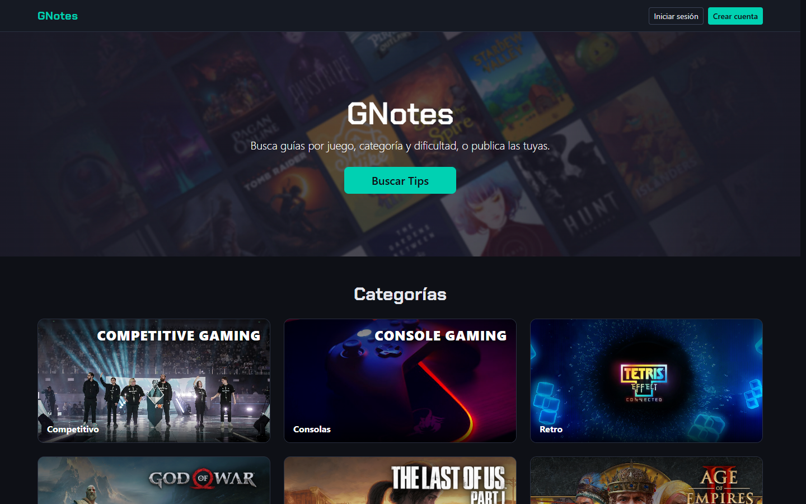 | 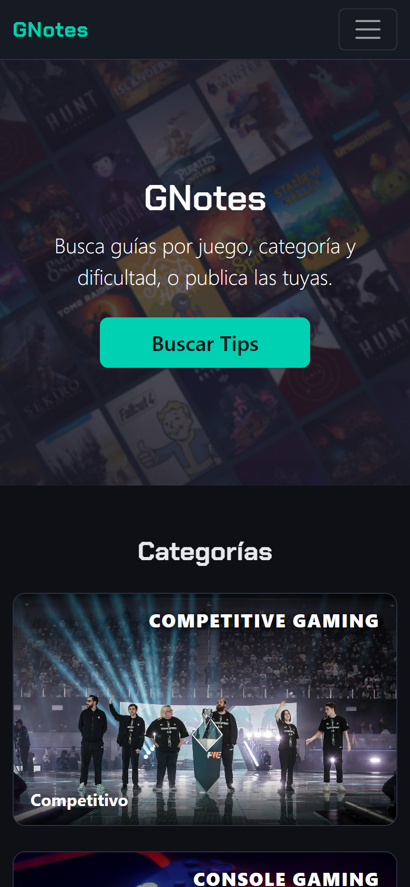 |
| Iniciar sesión | 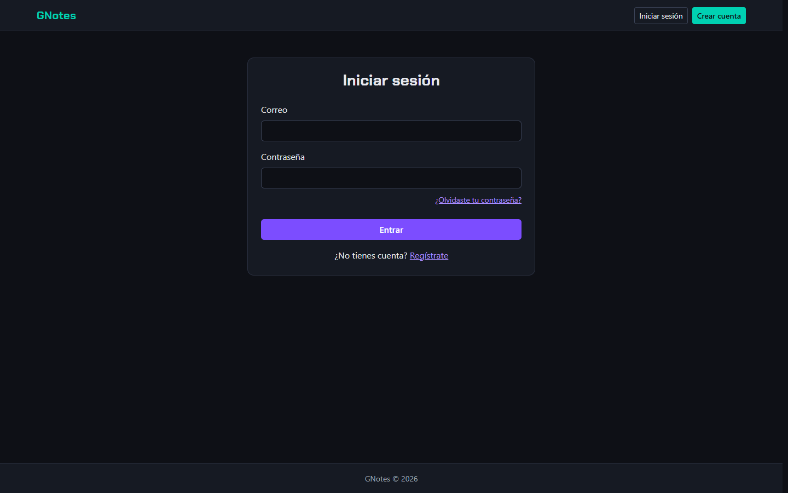 | 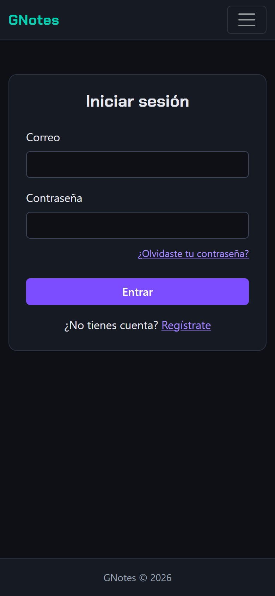 |
| Registro | 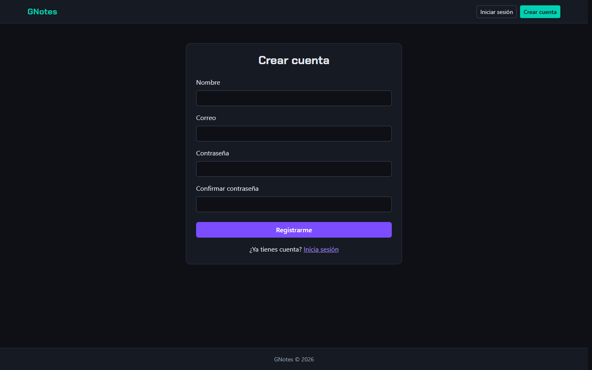 | 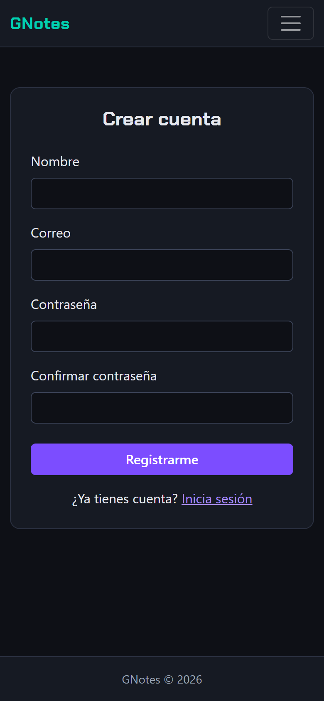 |
| Explorar | 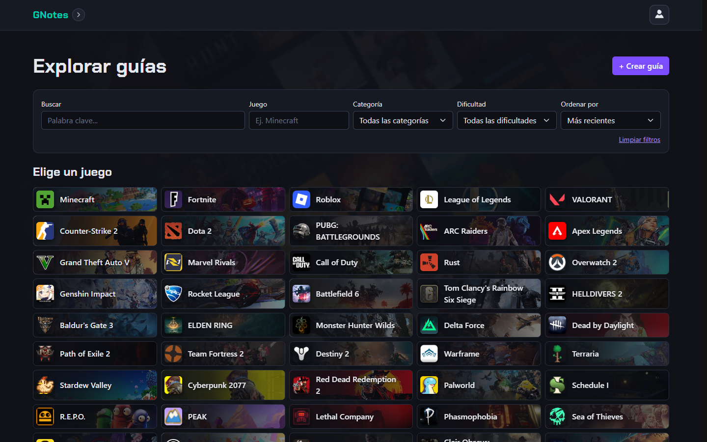 | 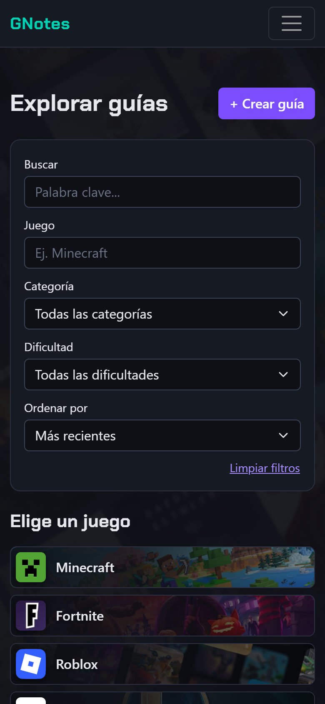 |
| Tips de un juego | 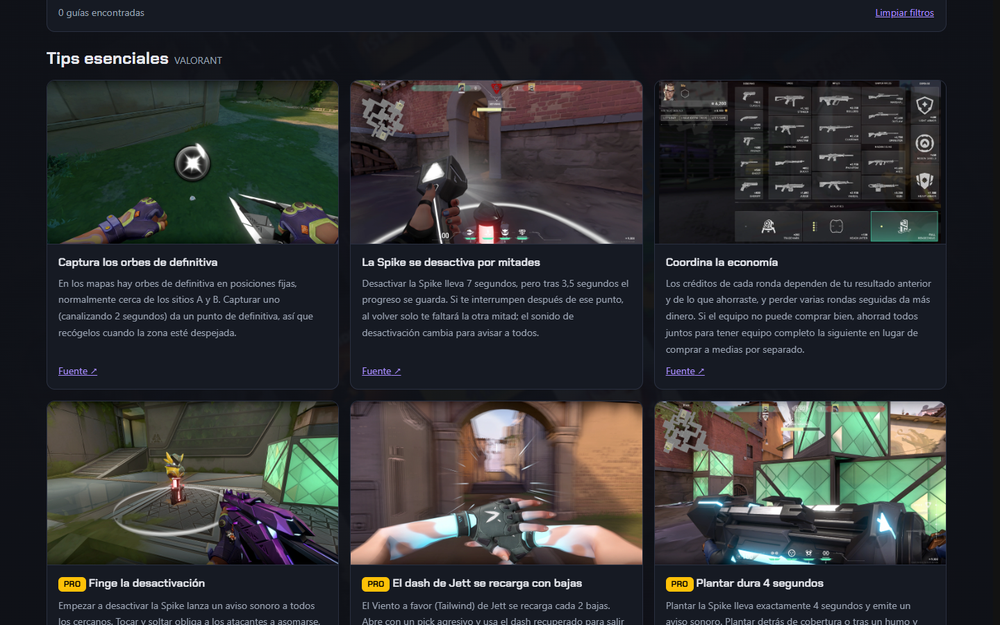 | 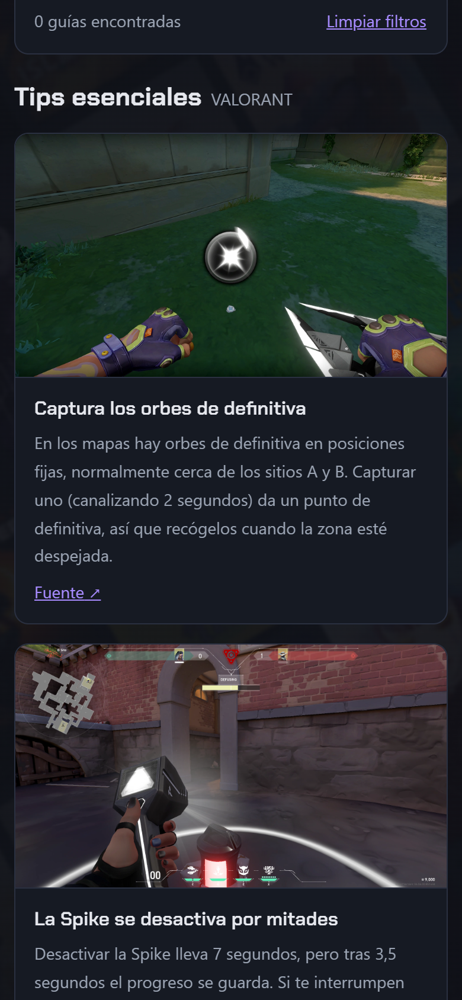 |
| Mi panel | 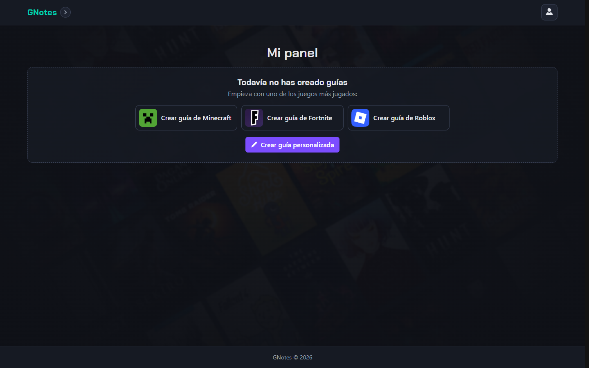 | 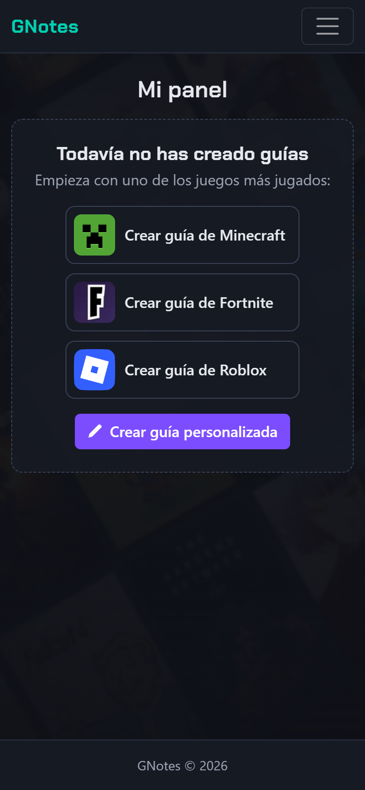 |
| Crear guía | 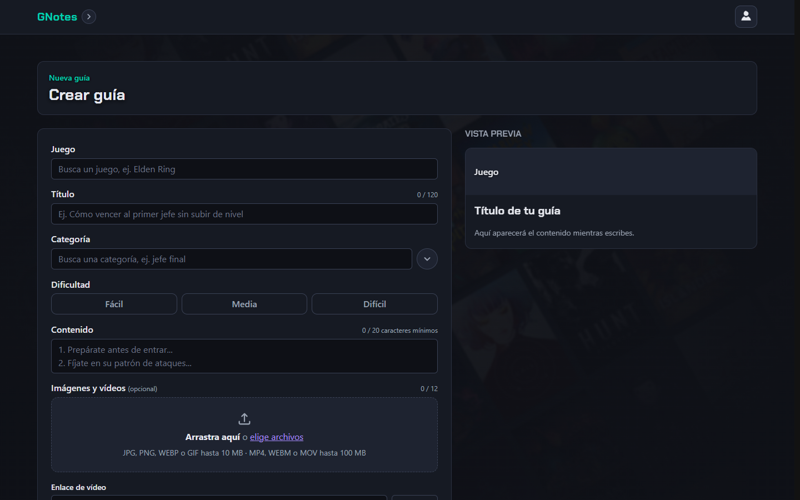 | 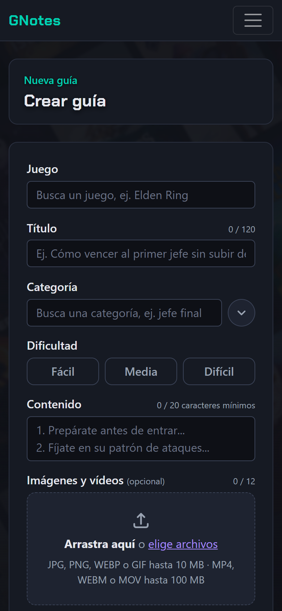 |
| Perfil | 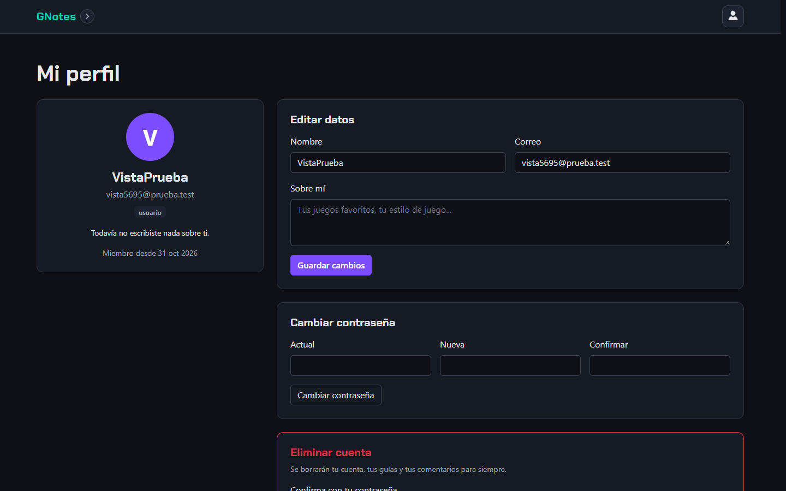 | 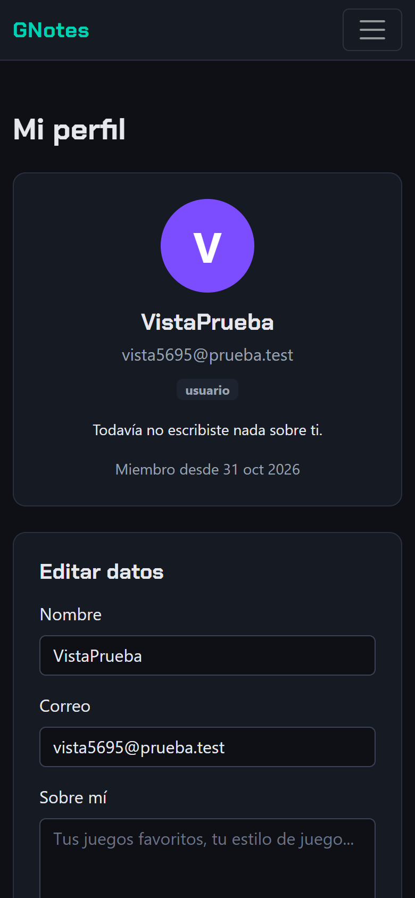 |
| Favoritos | 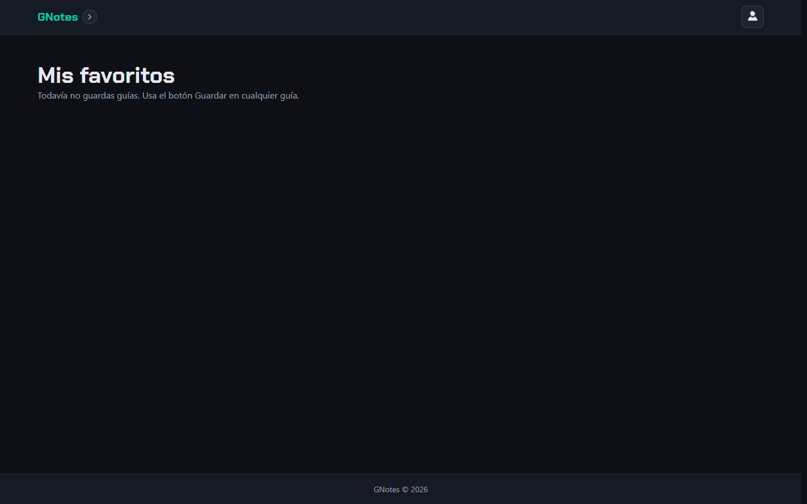 | 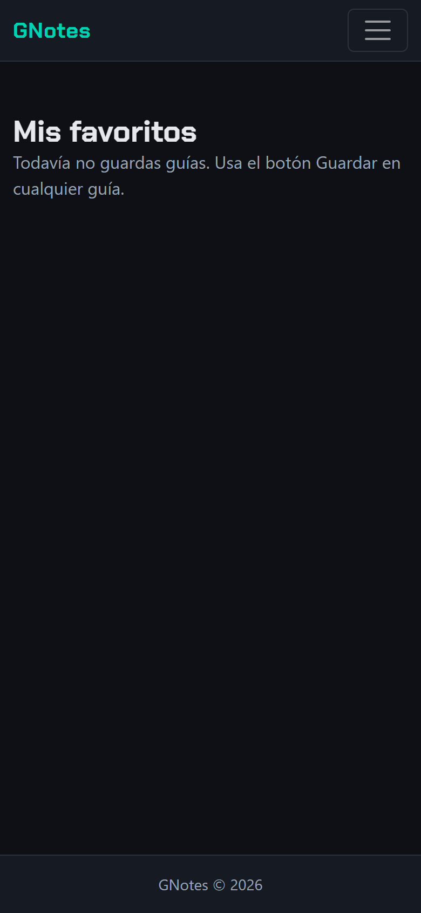 |

## Documentación

- [Pruebas](doc/pruebas.md): qué se probó y cómo.
- [Módulos](doc/modulos.md): paquetes que se usan.
- Documentación de interfaz: http://localhost:5002/pages/ui/documentacion.html

## Seguridad

- El archivo `.env` no se sube a GitHub (está en `.gitignore`). Usa `.env.example` como plantilla.
- Las contraseñas se guardan encriptadas con bcrypt y nunca se devuelven.
- La sesión usa un token JWT que vence a los 7 días.
- El cliente no puede fijar `_id`, rol, estado, votos ni otros campos internos: cada controlador toma solo los campos permitidos.
